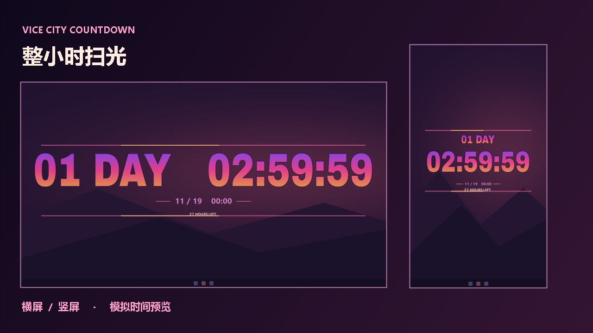
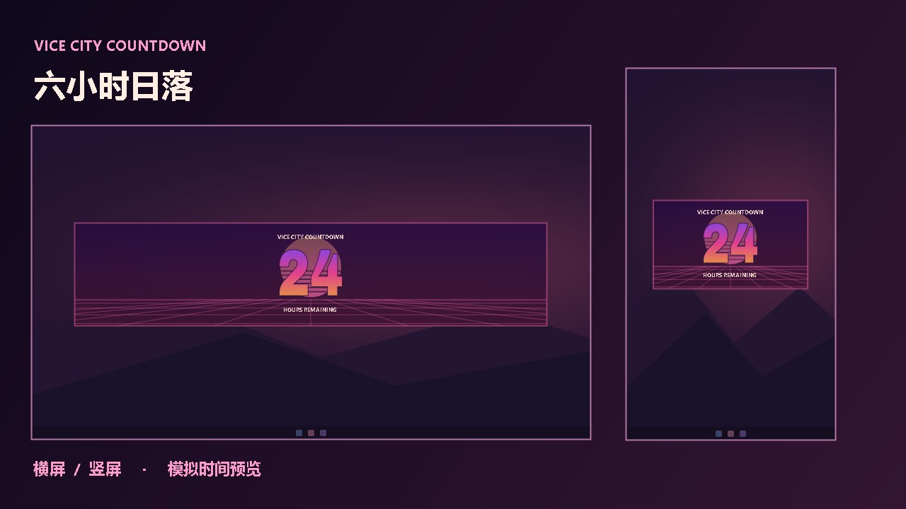
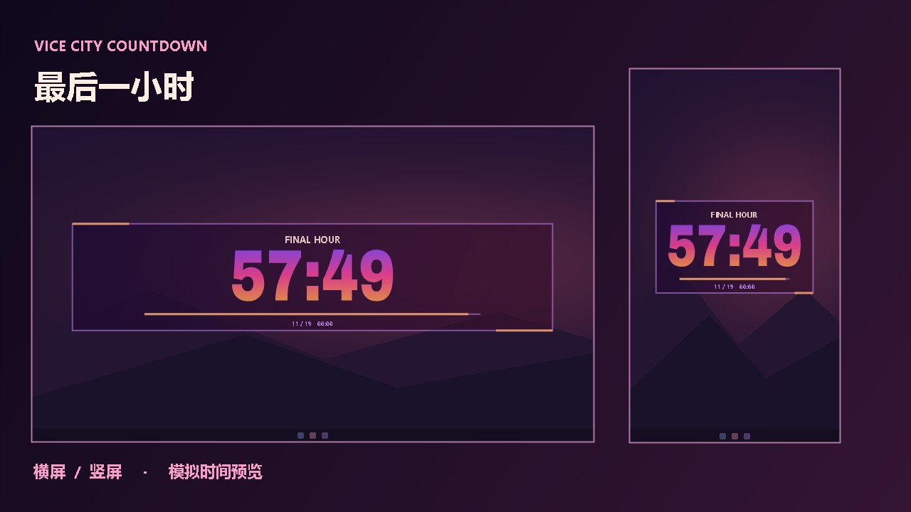
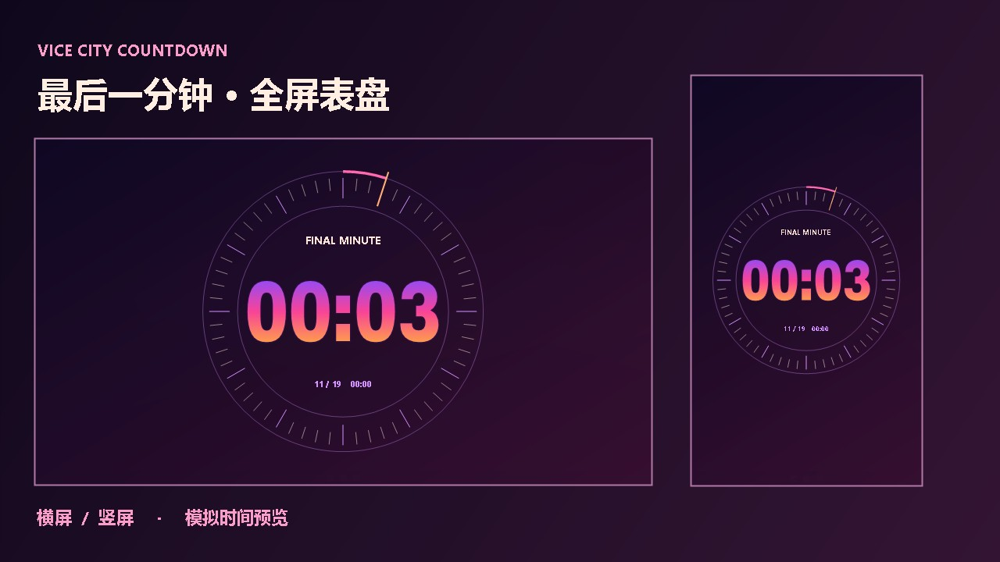

# 罪城倒计时 · Vice City Countdown

一款用于 Windows 桌面的半透明倒计时浮层。紫粉到暖橙的渐变、深紫描边和窄体数字取自罪城日落的配色思路。浮层置顶并支持鼠标穿透，横屏显示一行主字，竖屏将天数和时分秒分行。

## 使用

1. 从 [Releases](https://github.com/DaRin1403/vice-city-countdown/releases) 下载并完整解压 `ViceCityCountdown-Windows.zip`。
2. 双击 `ViceCityCountdown.exe`。默认倒数至北京时间 **2026 年 11 月 19 日 00:00**，默认不透明度为 31%。
3. 右键任务栏托盘里的倒计时图标，即可编辑配置、重载配置或退出。目标时间过去后浮层自动收起，托盘图标仍可用于设定下一次倒计时。

适用于 Windows 10 1703 及更新版本和 Windows 11，使用系统自带的 .NET Framework，解压后可运行。

## 阶段动画

动画按距离配置终点的剩余时间触发。六小时节点播放日落动画，最后一小时和最后一分钟各有独立界面。右键托盘图标，选择「预览动画」，可以立即预览任一阶段。

| 整小时扫光，约 2.6 秒 | 六小时日落，约 5.2 秒 |
| --- | --- |
|  |  |
| **最后一小时 · 分秒和进度条** | **最后一分钟 · 全屏表盘** |
|  |  |

上图以模拟时间展示横屏和竖屏。全屏表盘覆盖选中的显示器，仍可穿透鼠标。到零后显示约 10 秒，再回到托盘。

## 配置

修改程序旁的 `countdown.ini`，保存后从托盘菜单重载。

```ini
Deadline=2026-11-19T00:00:00+08:00
Displays=Auto
Opacity=31
```

- `Deadline` 含时区偏移。浮层上的日期显示为这个时区的时间。
- `Displays` 可填 `Auto`、`Primary`、`All` 或 `DISPLAY1,DISPLAY2` 这样的设备列表。自动模式优先使用同时在线的 `DISPLAY1` 和 `DISPLAY2`，否则使用主屏和至多一块副屏，并优先选择竖屏。
- `Opacity` 接受 1 到 100 的整数百分比，用于日常浮层。阶段动画会暂时增强不透明度，最后一分钟使用独立的全屏背景。

在 PowerShell 中可以查看设备名和屏幕排列。

```powershell
Add-Type -AssemblyName System.Windows.Forms
[System.Windows.Forms.Screen]::AllScreens | Select-Object DeviceName, Primary, Bounds
```

## 从源码构建

在 Windows PowerShell 或 PowerShell 中运行 `./build.ps1`，生成 `dist/` 和便携 ZIP。

这是独立运行的粉丝项目。随附的 [Archivo Black](https://github.com/google/fonts/tree/main/ofl/archivoblack) 字体使用 [SIL Open Font License 1.1](fonts/OFL.txt)。
